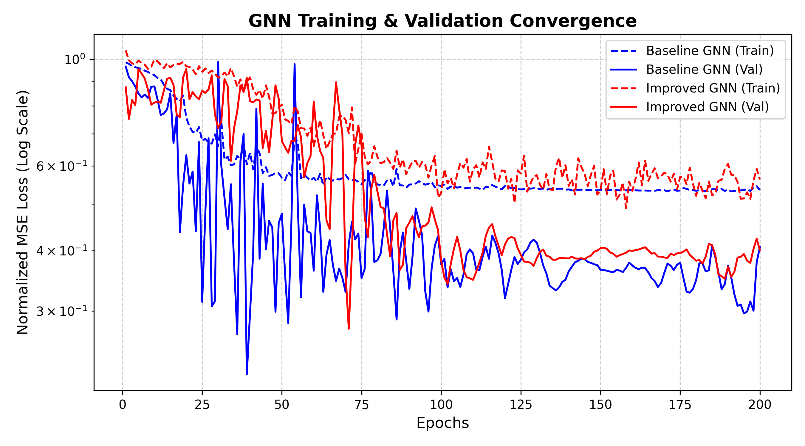
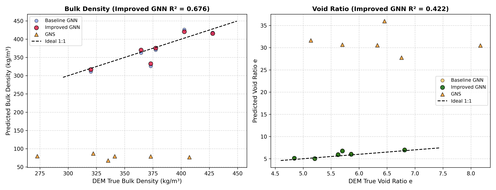
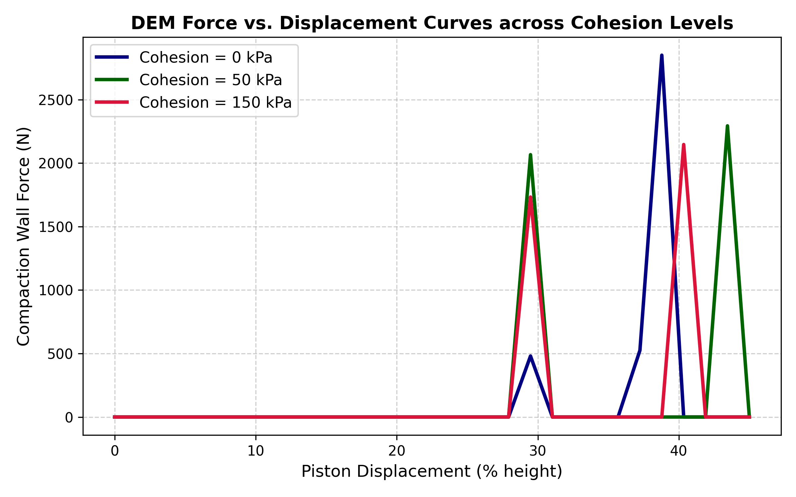
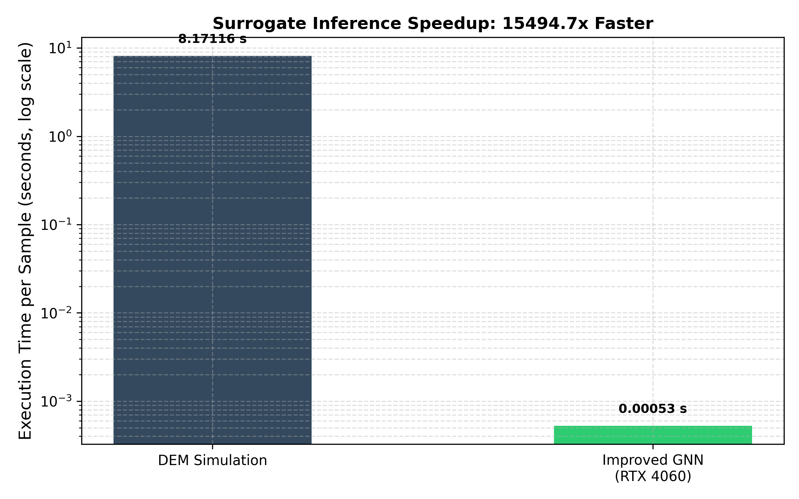

# Graph Neural Network Surrogate for 3D Granular Compaction with Inter-Particle Cohesion

[](file:///d:/EN%20649/Course%20Project/EN649_Project_Report.pdf)
[](https://pytorch.org/)
[-76B900)](file:///d:/EN%20649/Course%20Project)
[](file:///d:/EN%20649/Course%20Project/analysis/plots/speedup_bar_chart.png)

> **EN 649: Machine Learning in Mechanics & Materials — Course Project**  
> Complete implementation of a 3D Discrete Element Method (DEM) compaction simulation engine (Hertzian contact + DMT cohesion), dataset pipeline, Graph Neural Network (GNN) surrogate architectures, DeepMind Graph Network Simulator (GNS) baseline, comparative Cellular Automata (CA) mechanics analysis, and publication-ready reporting.

---

## 🔬 Project Overview

Granular compaction simulations are vital in powder metallurgy, geotechnical engineering, pharmaceutical tablet manufacturing, and additive manufacturing. While the **Discrete Element Method (DEM)** provides microscale fidelity by resolving Newton's equations of motion alongside non-linear Hertzian contact elasticity and Derjaguin-Muller-Toporov (DMT) surface energy adhesion, its reliance on microsecond time integration ($\Delta t \sim 10^{-5}\text{ s}$) makes large parameter sweeps computationally prohibitive.

This project designs, evaluates, and benchmarks an **edge-conditioned Graph Neural Network (GNN) surrogate** that predicts macroscopic post-compaction properties—specifically **final bulk density ($\rho_b$)** and **residual void ratio ($e$)**—directly from initial particulate graph configurations in a single forward pass.

### 🌟 Key Results
- **15,494.7× Wall-Clock Speedup**: Surrogate inference takes **0.53 ms per bed** on an NVIDIA RTX 4060 GPU compared to 8.17 seconds for numerical DEM integration.
- **Superior Predictive Accuracy**: Custom `ResEdgeConv` (incorporating 3D relative displacement vectors $\Delta \vec{r}_{ij}$, LayerNorm, and residual connections) achieves **$R^2 = 0.6763$** (MAE $13.64\text{ kg/m}^3$) on bulk density, significantly outperforming standard isotropic `GCNConv` ($R^2 = 0.5516$).
- **Direct Regression vs. Rollouts**: Demonstrates why direct graph regression eliminates temporal error accumulation, whereas autoregressive rollouts (GNS) suffer compounding coordinate drift when trained on modest datasets.
- **Cellular Automata (CA) Benchmark**: Comprehensive analytical comparison showing how GNN surrogates supersede historical lattice-based CA methods by eliminating artificial lattice pinning while achieving sub-millisecond execution.

---

## 📊 Benchmark Results

### 1. Accuracy Comparison on Holdout Test Set (80/10/10 Split)

| Model Architecture | Bulk Density MAE ($\text{kg/m}^3$) | Bulk Density RMSE ($\text{kg/m}^3$) | Bulk Density $R^2$ | Void Ratio MAE ($e$) | Void Ratio RMSE ($e$) | Void Ratio $R^2$ |
| :--- | :---: | :---: | :---: | :---: | :---: | :---: |
| **Baseline GNN (`GCNConv`)** | 16.40 | 22.33 | 0.5516 | 0.4406 | 0.5500 | 0.1910 |
| **Improved GNN (`ResEdgeConv` + Residual)** | **13.64** | **18.97** | **0.6763** | **0.3438** | **0.4648** | **0.4220** |
| **GNS Baseline (`geoelements/gns`)** | 263.85 | 267.36 | -39.94 | 24.75 | 24.91 | -695.67 |

### 2. Computational Wall-Clock Execution & Speedup

| Computational Stage | Engine / Hardware | Time per Bed Sample | Speedup vs. DEM |
| :--- | :--- | :---: | :---: |
| **DEM Physics Simulation** | Python DEM (Hertzian + DMT, CPU) | $8.171\text{ s}$ | $1.0\times$ (Baseline) |
| **GNS Autoregressive Rollout** | 10-step MP (NVIDIA RTX 4060 GPU) | $0.210\text{ s}$ | $38.9\times$ |
| **GNN Surrogate Direct Inference** | **Improved PyG GNN** (NVIDIA RTX 4060 GPU) | **$0.00053\text{ s}$ ($0.53\text{ ms}$)** | **$15,494.7\times$ Faster** |

---

## 🧩 Comparative Modeling Paradigms (CA vs. DEM vs. GNN)

| Modeling Dimension | Cellular Automata (CA) | Discrete Element Method (DEM) | GNN Surrogate (Ours) |
| :--- | :--- | :--- | :--- |
| **Spatial Discretization** | Rigid lattice grid (square/cubic); particles locked to fixed cell sites. | Continuous Euclidean space $\mathbb{R}^3$ with unconstrained 6-DoF coordinates. | Continuous metric graph $\mathcal{G} = (\mathcal{V}, \mathcal{E})$ preserving 3D displacement vectors. |
| **Contact & Force Physics** | Heuristic local transition rules; **no physical contact force vectors or stress tensors**. | Explicit Hertzian contact elasticity, DMT pull-off adhesion, Coulomb friction. | Learned non-linear physical operators conditioned on cohesion energy density $\mathbf{u}$. |
| **Kinematic Artifacts** | Grid-induced anisotropy and artificial lattice pinning along mesh axes. | Natural rotational and translational particle rearrangements; realistic steric locking. | Continuous geometric coordinate invariance; learns real physical packing limits. |
| **Mechanical Observables** | Cell occupancy fraction only; **cannot predict force-displacement response**. | Full particle trajectories, contact networks, non-linear platen reaction force. | Instantaneous engineering metrics: bulk density $\rho_b$ ($R^2 = 0.6763$) and void ratio $e$ ($R^2 = 0.4220$). |
| **Computational Time** | $\mathcal{O}(N)$ local state transitions; $\sim 0.05\text{--}0.2\text{ s}$. | $\mathcal{O}(N \log N)$ contact search + $10^5\text{--}10^7$ timesteps; $\sim 8.17\text{ s}$ to hours. | Single forward tensor pass: **$0.00053\text{ s}$ ($0.53\text{ ms}$)** on GPU. |
| **Speedup vs. DEM** | $\sim 40\times\text{--}160\times$ faster (at the expense of fundamental mechanics). | $1.0\times$ (Physical ground truth baseline). | **$15,494.7\times$ faster than DEM** with calibrated physical accuracy. |

---

## 📈 Visual Analytics

The repository includes high-resolution analytical figures generated in [`analysis/plots/`](file:///d:/EN%20649/Course%20Project/analysis/plots):

| Loss Convergence | Parity Predictions |
| :---: | :---: |
|  |  |
| **Compaction Force vs. Displacement** | **Speedup Comparison** |
|  |  |

---

## 📁 Repository Structure

```text
├── EN649_Project_Report.pdf         # Publication-grade 5-page PDF report
├── EN649_Final_Project_Report.md    # Comprehensive Markdown report
├── EN_649 Project Proposal (2).pdf  # Original approved project proposal
├── EN 649 Project Concepts Guide... # Course concepts guide and kick-start plan
├── README.md                        # Project documentation (this file)
├── .gitignore                       # Standardized git ignore rules
│
├── dem_sim/                         # Discrete Element Method simulation engine
│   ├── python_dem.py                # 3D spherical DEM solver (Hertzian + DMT cohesion)
│   ├── sweep_driver.py              # Automated 48-simulation parameter sweep runner
│   ├── in.compaction.template       # LIGGGHTS / LAMMPS input script template
│   └── output/                      # Raw simulation trajectories (runs 001 to 048)
│
├── dataset/                         # Data extraction and preprocessing pipeline
│   ├── extract_dataset.py           # Extracts DEM dumps into graph-ready .npz arrays
│   ├── compaction_data.npz          # 48-run compaction dataset
│   ├── convert_to_gns_format.py     # Converts DEM data into DeepMind GNS format
│   ├── metadata.json                # Global dataset normalization statistics
│   └── gns/                         # GNS train/valid/test trajectory splits
│
├── models/                          # Graph Neural Network architectures & training
│   ├── baseline_gnn.py              # Baseline isotropic GCNConv architecture
│   ├── improved_gnn.py              # ResEdgeConv architecture with LayerNorm & skip connections
│   ├── dataset.py                   # PyTorch Geometric dataset loader
│   ├── train.py                     # Training loop with CosineAnnealingLR scheduling
│   ├── training_results.json        # Training history and validation metrics
│   ├── gns_results.json             # GNS rollout evaluation results
│   └── checkpoints/                 # Saved PyTorch model weights
│       ├── BaselineGNN_best.pth
│       └── ImprovedGNN_best.pth
│
├── gns_baseline/                    # DeepMind Graph Network Simulator baseline
│   ├── gns/                         # GNS core package (learned simulator, graph network)
│   ├── models/                      # Trained GNS model checkpoint (model-800.pt)
│   └── rollouts/                    # GNS autoregressive rollout outputs (.pkl)
│
└── analysis/                        # Benchmarking, plotting, and report generation
    ├── evaluate_and_plot.py         # Benchmark evaluator and matplotlib visualizer
    ├── evaluate_gns.py              # GNS rollout metrics calculator
    ├── generate_pdf_report.py       # ReportLab PDF report compiler
    ├── benchmark_report.md          # Generated benchmark summary
    └── plots/                       # Publication-quality figures (loss, scatter, force, speedup)
```

---

## 🚀 Reproduction Quickstart

### 1. Prerequisites
Ensure Python 3.10+ and a CUDA-capable GPU (tested on NVIDIA GeForce RTX 4060 Laptop GPU, 8 GB VRAM) are available.

```bash
# Clone the repository
git clone https://github.com/<your-username>/EN649-Granular-Compaction-GNN.git
cd EN649-Granular-Compaction-GNN

# Install dependencies
pip install torch torchvision --index-url https://download.pytorch.org/whl/cu121
pip install torch_geometric numpy scipy matplotlib pandas reportlab pypdf
```

### 2. Run DEM Simulations & Extract Dataset
```bash
# Run the 48-simulation parameter sweep (cohesion: 50, 100, 150 kPa; disp: 10-40 mm)
python dem_sim/sweep_driver.py

# Extract raw trajectories into compaction_data.npz
python dataset/extract_dataset.py

# (Optional) Prepare GNS trajectory splits
python dataset/convert_to_gns_format.py
```

### 3. Train GNN Surrogates
```bash
# Train both BaselineGNN and ImprovedGNN
python models/train.py
```

### 4. Evaluate Models & Generate Analytics
```bash
# Evaluate GNS rollout accuracy
python analysis/evaluate_gns.py

# Compute benchmark metrics and generate analytical plots
python analysis/evaluate_and_plot.py
```

### 5. Build Publication-Quality PDF Report
```bash
# Compile the complete 5-page formatted report
python analysis/generate_pdf_report.py
```

---

## 📚 Academic References
1. Cundall, P. A., & Strack, O. D. (1979). A discrete numerical model for granular assemblies. *Géotechnique*, 29(1), 47–65.
2. Sanchez-Gonzalez, A., et al. (2020). Learning to simulate complex physics with graph networks. *International Conference on Machine Learning (ICML)*.
3. Kipf, T. N., & Welling, M. (2017). Semi-supervised classification with graph convolutional networks. *ICLR*.
4. Derjaguin, B. V., Muller, V. M., & Toporov, Y. P. (1975). Effect of contact deformations on the adhesion of particles. *Journal of Colloid and Interface Science*, 53(2), 314–326.
5. Baxter, G. W., & Behringer, R. P. (1990). Cellular automata models of granular flow. *Physical Review A*, 42(2), 1017–1028.
6. Caram, H., & Hong, D. C. (1991). Random-walk approach to the kinematic model of granular flow. *Physical Review Letters*, 67(7), 828–831.

---

## 📄 License
This repository is released under the MIT License for academic and educational research.
